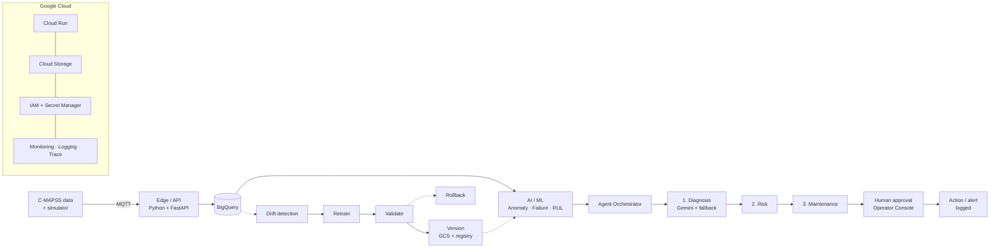

# Risk-Aware Multi-Agent AI for Self-Healing Industrial Predictive Maintenance

An end-to-end predictive-maintenance system for turbofan engines. It streams sensor data, predicts failures, explains them with an LLM, scores the risk, waits for a human to approve every action, and keeps its own models healthy through drift detection and retraining. The whole system is deployed on Google Cloud.

> **M.Tech Data Science (NMIMS), Advanced Industry Integrated Program with LTIMindTree**
> Author: **Manav Mabian**

---

## Live system

| What | Link | Access |
|---|---|---|
| **Operator Console** (dashboard) | https://pdm-dashboard-necm52e4nq-el.a.run.app | Username and password |
| **REST API** (FastAPI + agents) | https://pdm-api-363641793280.asia-south1.run.app | IAM-protected; a browser gets `403` by design |

Hosted on Google Cloud Run, region `asia-south1` (Mumbai).

---

## Demo video

▶ **Watch the demo:** (https://drive.google.com/file/d/1l3AyNacNFs7nPZnMliYzXrTmzJMTQWp3/view?usp=sharing))

The video shows a live engine streaming through the edge pipeline, Gemini diagnoses, risk scoring, approval in the Operator Console, the machine-history charts, and the Google Cloud services (Cloud Run, BigQuery, Cloud Build, Cloud Scheduler).

---

## What it does

```
Sensor stream ──► Edge validation & features ──► ML predictions ──► Diagnosis ──► Risk ──► Maintenance ──► Human approval ──► Logged action
                                                        ▲                                                            
                              Drift check ─► Retrain ─► Validate ─► Version ─► Rollback  (self-healing MLOps loop)
```

1. **Predict:** an anomaly score, the probability of failure within 30 cycles, and the Remaining Useful Life (RUL).
2. **Explain:** Google Gemini writes an engineering diagnosis. If Gemini is slow or unavailable, a deterministic template takes over within 10 seconds, so no alert is lost.
3. **Prioritise:** an auditable risk score: `risk = 0.5·P(fail) + 0.3·RUL urgency + 0.2·anomaly`. Thresholds are LOW < 0.40 ≤ MEDIUM < 0.70 ≤ HIGH.
4. **Human in control:** MEDIUM and HIGH decisions wait in the Operator Console. Nothing is actioned until someone approves it, and every approval or rejection is stored in BigQuery.
5. **Self-heal:** a nightly drift check retrains the models when sensor data drifts. A new model replaces the old one only if it performs better.

---

## Architecture



| Layer | Implementation |
|---|---|
| Data | NASA C-MAPSS FD001–FD004 turbofan run-to-failure data, replayed as live telemetry |
| Ingestion | Eclipse Mosquitto (MQTT), topic `plant/<machine>/sensors` |
| Edge | Pydantic validation, detection of 6 operating conditions with per-condition normalisation, and 56 features (14 sensors + 10-cycle mean, std and delta) |
| Storage | BigQuery: 7 tables (`raw_sensor_data`, `feature_data`, `predictions`, `agent_decisions`, `maintenance_actions`, `model_registry`, `drift_events`) |
| Models | XGBoost RUL regressor (cap 125), XGBoost failure classifier (≤ 30 cycles), Isolation Forest anomaly detector |
| Agents | Diagnosis (Gemini `flash-lite`, 10 s timeout, template fallback) → Risk (deterministic) → Maintenance |
| Serving | FastAPI on Cloud Run (`pdm-api`), Streamlit Operator Console on Cloud Run (`pdm-dashboard`) |
| MLOps | Kolmogorov–Smirnov drift test → retrain → validate against production → version in GCS + registry → rollback |
| CI/CD | Push to `main` → Cloud Build builds, tests, pushes to Artifact Registry and deploys both services |
| Security | Least-privilege service accounts, IAM-protected API, secrets in Secret Manager, pre-commit check that blocks API keys |
| Observability | Cloud Logging, Cloud Trace, and a Cloud Monitoring alert on the API error rate |

---

## Results

Tested on the official NASA test sets (707 engines), using one model for all four fleets:

| Dataset | Conditions / fault modes | RUL RMSE | RUL MAE | Failure ROC-AUC | Anomaly ROC-AUC |
|---|---|---|---|---|---|
| FD001 | 1 / 1 | 13.69 | 10.06 | 0.9970 | 0.9939 |
| FD002 | 6 / 1 | 14.29 | 10.33 | 0.9944 | 0.9836 |
| FD003 | 1 / 2 | 15.60 | 11.39 | 0.9971 | 0.9743 |
| FD004 | 6 / 2 | 16.25 | 11.88 | 0.9945 | 0.9537 |
| **Combined** | — | **15.11** | **10.99** | **0.9951** | **0.9676** |

- **Live end-to-end run:** 926 readings across all four fleets, with 0 rejected, 0 errors and 158 decisions escalated for approval.
- **Train/serve parity:** the same feature code is used in training and live serving (maximum difference 1e-14).
- **Self-healing:** drift was detected and retraining triggered on the cloud. A weaker challenger (RMSE 15.13 vs 15.11) was correctly rejected.

---

## Repository layout

```
├── edge/                 # MQTT simulator + edge pipeline
│   ├── simulator.py      #   replays C-MAPSS engines as live sensor messages
│   ├── pipeline.py       #   validate → normalise → features → predict → agents
│   └── telemetry.py      #   SensorReading schema, MQTT settings
├── ml/                   # data prep, training, inference, MLOps
│   ├── conditions.py     #   operating-condition normaliser + feature builder (shared train/serve)
│   ├── prepare_data_v3.py
│   ├── train_v3.py
│   ├── inference.py      #   loads production models via the registry
│   ├── model_store.py    #   GCS + BigQuery model registry
│   ├── drift_detector.py #   KS drift test
│   ├── retrain.py        #   retrain + validate + promote
│   └── rollback.py
├── agents/               # diagnosis_agent.py, risk_agent.py, maintenance agent, orchestrator
├── api/                  # FastAPI app (main.py) + BigQuery storage (storage.py)
├── dashboard/            # Streamlit Operator Console (app.py, Dockerfile, requirements.txt)
├── Dockerfile            # API image
├── cloudbuild.yaml       # CI/CD: build, test, push, deploy API + dashboard
└── run_demo.sh           # one-command local demo
```

---

## Run it locally

### Prerequisites
- Python 3.11+
- Docker Desktop (runs the MQTT broker)
- Google Cloud SDK (`gcloud`), signed in to the project, for BigQuery and the cloud API
- Optional: a Gemini API key for LLM diagnoses. Without one, the template fallback is used.

### 1. Clone and install
```bash
git clone https://github.com/manav-17/pdm-self-healing.git
cd pdm-self-healing
python3 -m venv venv && source venv/bin/activate
pip install -r requirements_api.txt -r dashboard/requirements.txt
```

### 2. Authenticate to Google Cloud
```bash
gcloud auth login
gcloud auth application-default login
gcloud config set project project-c3e3f3ae-71cf-45cb-800
```

### 3. Configure secrets (never commit these)
Create a `.env` file in the project root. It is git-ignored.
```bash
GEMINI_API_KEY=<your Gemini key>      # optional
GEMINI_MODEL=gemini-flash-lite-latest
```
On Cloud Run the key is read from Secret Manager (`gemini-api-key`) instead.

### 4. Run the live demo
Make sure Docker Desktop is running, then:
```bash
./run_demo.sh                          # default: FD004, engine 1
DATASET=FD002 ENGINE=5 ./run_demo.sh   # any of FD001–FD004 and any engine
USE_LLM=false ./run_demo.sh            # template diagnoses only (no Gemini calls)
```
The script starts Mosquitto in Docker, starts the edge pipeline, replays the engine, and prints a summary of processed, rejected, escalated, LLM and template counts. Escalated decisions go to the cloud API and appear in the Operator Console.

Each pipeline line looks like:
```
fd002_engine_005 c 142 | cond=3 RUL=12.4 | risk=0.81 HIGH | IMMEDIATE_INSPECTION  -> queued [llm]
```

### 5. Run the Operator Console locally
```bash
DASHBOARD_USERS='{"demo":"demo123"}' \
API_URL=https://pdm-api-363641793280.asia-south1.run.app \
API_TOKEN=$(gcloud auth print-identity-token) \
streamlit run dashboard/app.py
```
Open http://localhost:8501 and sign in with `demo` / `demo123`. This login works only on your machine; the live site's accounts are in Secret Manager.

### 6. (Optional) Run the API locally
```bash
uvicorn api.main:app --reload --port 8000
API_URL=http://localhost:8000 ./run_demo.sh
```

### 7. (Optional) Rebuild the data and models
Download the C-MAPSS files (`train_FD00x.txt`, `test_FD00x.txt`, `RUL_FD00x.txt`) into `data/raw/`, then:
```bash
python ml/prepare_data_v3.py   # normalise per condition, build features, parity test
python ml/train_v3.py          # train + evaluate all three models, write models/*.pkl
```

---

## Cloud deployment

Deployment is automatic: **every push to `main` redeploys both services** through Cloud Build (`cloudbuild.yaml`):

1. Build the API image, then smoke-test `import api.main`.
2. Push to Artifact Registry and deploy `pdm-api` to Cloud Run.
3. Build the dashboard image, then check that `dashboard/app.py` compiles.
4. Push and deploy `pdm-dashboard` to Cloud Run.

To check the latest build:
```bash
gcloud builds list --limit=1
```

### Managing dashboard users
Accounts are stored in the Secret Manager secret `dashboard-users` as a JSON map of `username → password`. To add or change users, publish a new version that contains **all** users:
```bash
python3 -c 'import getpass,json; print(json.dumps({"manav": getpass.getpass("Password: ")}))' \
  | gcloud secrets versions add dashboard-users --data-file=-
```
Changes take effect within about 5 minutes, with no redeploy.

### MLOps schedule
Cloud Scheduler job `pdm-drift-check` calls `POST /mlops/check-drift` every night at **02:00 IST**:
- Drift: KS test on 14 sensor features. A feature counts as drifted if p < 0.05 and KS > 0.2.
- Retrain if more than 30% of features drift. The challenger is promoted only if it beats production on held-out data.
- Every check is logged to `drift_events`. Model versions are tracked in `model_registry`, with artifacts in Cloud Storage.

---

## API endpoints

| Method | Endpoint | Purpose |
|---|---|---|
| GET | `/health` | Service status and Cloud Run revision |
| POST | `/ingest` | Accept a sensor reading |
| POST | `/predict` | Anomaly, failure probability and RUL for a feature vector |
| POST | `/agents/evaluate` | Run Diagnosis → Risk → Maintenance |
| GET | `/decisions/pending` | Decisions awaiting human approval |
| POST | `/approvals/{decision_id}` | Approve or reject (`{"decision", "approver", "note"}`) |
| POST | `/mlops/check-drift` | Drift check, then retrain and validate if needed |

All endpoints require a Google identity token (`Authorization: Bearer $(gcloud auth print-identity-token)`).

---

## Limitations and future work

- Uses NASA C-MAPSS simulated data; the next step is real plant data through IoT gateways.
- The two fault modes in FD003/FD004 (HPC vs fan) are not classified separately.
- Gemini free-tier rate limits mean some diagnoses use the template fallback during long runs.
- Retraining reuses historical data; a production version would retrain on newly labelled data.
- Possible extensions: integration with maintenance work-order systems, and per-asset criticality weights.

---

## References

1. Saxena, A., Goebel, K., Simon, D., & Eklund, N. (2008). *Damage propagation modeling for aircraft engine run-to-failure simulation.* PHM 2008.
2. Chen, T., & Guestrin, C. (2016). *XGBoost: A scalable tree boosting system.* KDD.
3. Liu, F. T., Ting, K. M., & Zhou, Z.-H. (2008). *Isolation Forest.* ICDM.
4. Massey, F. J. (1951). *The Kolmogorov–Smirnov test for goodness of fit.* JASA.
5. Sculley, D., et al. (2015). *Hidden technical debt in machine learning systems.* NeurIPS.

---

## Acknowledgements

NMIMS and LTIMindTree (Advanced Industry Integrated Program), L&T EduTech, the project guide and mentors, and the NASA Prognostics Center of Excellence for the C-MAPSS dataset.
